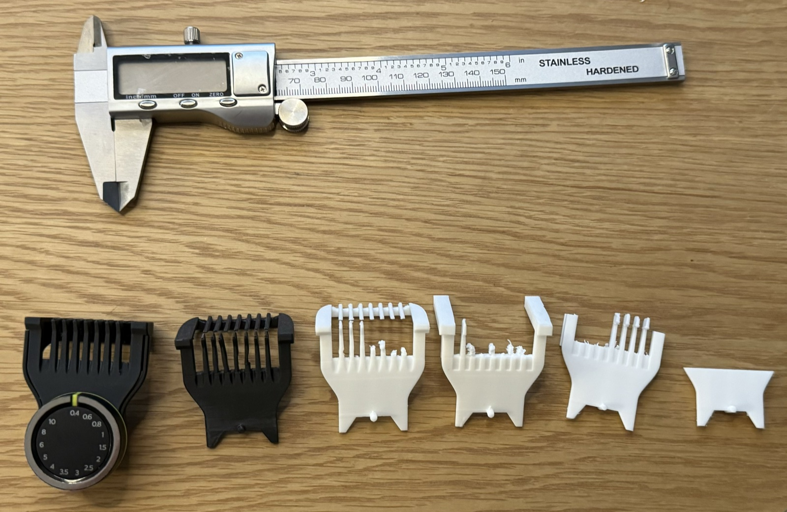
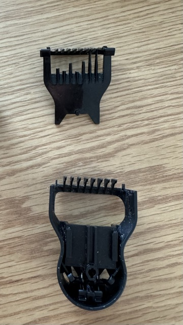

# Philips OneBlade Pro 360 comb

Replacement for the sliding comb of the Philips OneBlade Pro 360 adjustable
beard comb attachment
([CP2176/01](https://www.philips.fi/c-p/CP2176_01/oneblade-pro-360-back-pack-kampa)),
the 20-setting attachment for 0.4–10 mm.

From left: the attachment with the printed comb fitted, another printed comb,
and earlier prototypes in white.

The comb moves vertically on a track in the other half of the attachment. That
half and the dial are not included; reuse the ones from your original
attachment. To swap the comb, pull the dial off.

The original comb with broken teeth (top) and the other half of the attachment
with the track (bottom).

## Fits

Tested on the OneBlade Pro 360. It should fit any handle that takes the
original attachment, which Philips lists as:

- OneBlade Pro 360 Face + Body: QP6652/61, QP6552/30, QP6652/30, QP6542/15,
  QP6651/35
- OneBlade Pro Face + Body: QP6550/17
- OneBlade Pro Face: QP6530/15

## Files

| File | Description |
| --- | --- |
| `philips-oneblade-pro-360-comb.stl` | One piece, 40.6 × 42.6 × 23.7 mm |
| `philips-oneblade-pro-360-comb-split.stl` | Same part in two pieces, to be glued together |

The comb has a 90° bend, which makes it hard to print in one piece so that
both sections are strong enough. The split version prints as two pieces that
you glue together with superglue.

## Printing

Printed on a Bambu Lab A1 mini and has held up well in use.

- Nozzle: 0.4 mm
- Process: 0.08mm Extra Fine @BBL A1M, 2 walls, 90% infill
- Material: matte black PLA (Bambu PLA Basic profile), 220 °C
- Plate: smooth PEI
- Supports: tree (auto)
